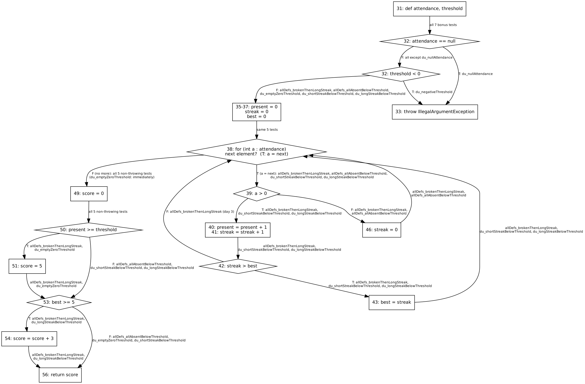

# Lab 10 – Data-flow testing (DU pairs)

## Part A – gcd (lines 13–20)

| # | Var | Def | Use | Type | Def-clear path | Test ID | Covered |
|---|-----|-----|-----|------|----------------|---------|---------|
| 1 | x | 13 | 16 | c-use | 13→15→16 | twoIterations | ✔ |
| 2 | x | 13 | 20 | c-use | 13→15→20 | zeroIterations | ✔ |
| 3 | x | 17 | 16 | c-use | 17→18→15→16 | twoIterations | ✔ |
| 4 | x | 17 | 20 | c-use | 17→18→15→20 | twoIterations | ✔ |
| 5 | y | 13 | (15,T) | p-use | 13→15→16 | twoIterations | ✔ |
| 6 | y | 13 | (15,F) | p-use | 13→15→20 | zeroIterations | ✔ |
| 7 | y | 13 | 16 | c-use | 13→15→16 | twoIterations | ✔ |
| 8 | y | 13 | 17 | c-use | 13→15→16→17 | twoIterations | ✔ |
| 9 | y | 18 | (15,T) | p-use | 18→15→16 | twoIterations | ✔ |
| 10 | y | 18 | (15,F) | p-use | 18→15→20 | twoIterations | ✔ |
| 11 | y | 18 | 16 | c-use | 18→15→16 | twoIterations | ✔ |
| 12 | y | 18 | 17 | c-use | 18→15→16→17 | twoIterations | ✔ |
| 13 | tmp | 16 | 18 | c-use | 16→17→18 | twoIterations | ✔ |

Line 14 (`int tmp;`) is a declaration without a value, so it is not a def.

Tests (`GcdTest.java`):
- `zeroIterations` – gcd(7,0)=7. The loop runs 0 times. It is the ONLY test that covers
  x(13→20) and y(13→(15,F)), because these pairs need the loop to be skipped.
- `twoIterations` – gcd(12,8)=4. The loop runs 2 times: (12,8)→(8,4)→(4,0).
  Pairs whose def is inside the loop (17, 18) and whose use is at the top of the loop
  (15T, 16, 17) need a SECOND iteration: x(17→16), y(18→15T), y(18→16), y(18→17).
- Two tests together cover all 13 DU pairs (all-DU-pairs).

## Part B – bonus (lines 31–56)

### B1 – CFG


Line 38 (for-each): the condition "attendance has a next element" is a p-use of `attendance`;
on the T edge the next element is assigned to `a` (def of `a`).

### B2 – Def/use per line
```
31: def attendance, def threshold
32: p-use attendance (== null), p-use threshold (< 0)   [|| short-circuit: threshold only if attendance != null]
35: def present
36: def streak
37: def best
38: p-use attendance (has next?), def a
39: p-use a
40: c-use present, def present
41: c-use streak, def streak
42: p-use streak, p-use best
43: c-use streak, def best
46: def streak
49: def score
50: p-use present, p-use threshold
51: def score
53: p-use best
54: c-use score, def score
56: c-use score
```

### B3 – DU pairs
Test IDs: AD1 = allDefs_brokenThenLongStreak, AD2 = allDefs_allAbsentBelowThreshold,
DU1 = du_nullAttendance, DU2 = du_negativeThreshold, DU3 = du_emptyZeroThreshold,
DU4 = du_shortStreakBelowThreshold, DU5 = du_longStreakBelowThreshold

| # | Var | Def | Use | Type | Def-clear path | Test ID | Covered |
|---|-----|-----|-----|------|----------------|---------|---------|
| 1 | attendance | 31 | (32,T) | p | 31→32→33 | DU1 | ✔ |
| 2 | attendance | 31 | (32,F) | p | 31→32→32b | AD1 | ✔ |
| 3 | attendance | 31 | (38,T) | p | 31→32→35..37→38→39 | AD1 | ✔ |
| 4 | attendance | 31 | (38,F) | p | 31→32→35..37→38→49 | DU3 | ✔ |
| 5 | threshold | 31 | (32,T) | p | 31→32→32b→33 | DU2 | ✔ |
| 6 | threshold | 31 | (32,F) | p | 31→32→32b→35 | AD1 | ✔ |
| 7 | threshold | 31 | (50,T) | p | 31→…→49→50→51 | AD1 | ✔ |
| 8 | threshold | 31 | (50,F) | p | 31→…→49→50→53 | AD2 | ✔ |
| 9 | present | 35 | 40 | c | 35→36→37→38→39→40 | AD1 | ✔ |
| 10 | present | 35 | (50,T) | p | 35→…→38→49→50→51 | DU3 | ✔ |
| 11 | present | 35 | (50,F) | p | 35→…→38→(39F→46→38)*→49→50→53 | AD2 | ✔ |
| 12 | present | 40 | 40 | c | 40→41→42→(43)→38→39→40 | AD1 | ✔ |
| 13 | present | 40 | (50,T) | p | 40→41→42→…→38→49→50→51 | AD1 | ✔ |
| 14 | present | 40 | (50,F) | p | 40→41→42→…→38→49→50→53 | DU4 | ✔ |
| 15 | streak | 36 | 41 | c | 36→37→38→39→40→41 | AD1 | ✔ |
| 16 | streak | 41 | 41 | c | 41→42→(43)→38→39→40→41 | AD1 | ✔ |
| 17 | streak | 41 | (42,T) | p | 41→42→43 | AD1 | ✔ |
| 18 | streak | 41 | (42,F) | p | 41→42→38 | AD1 (day 3) | ✔ |
| 19 | streak | 41 | 43 | c | 41→42→43 | AD1 | ✔ |
| 20 | streak | 46 | 41 | c | 46→38→39→40→41 | AD1 (day 2→3) | ✔ |
| 21 | best | 37 | (42,T) | p | 37→38→39→40→41→42→43 | AD1 | ✔ |
| 22 | best | 37 | (42,F) | p | 37→38→39→40→41→42→38 | – | infeasible |
| 23 | best | 37 | (53,T) | p | 37→38→49→50→53→54 | – | infeasible |
| 24 | best | 37 | (53,F) | p | 37→38→…→49→50→53→56 | AD2 | ✔ |
| 25 | best | 43 | (42,T) | p | 43→38→39→40→41→42→43 | AD1 | ✔ |
| 26 | best | 43 | (42,F) | p | 43→38→39→46→38→39→40→41→42→38 | AD1 | ✔ |
| 27 | best | 43 | (53,T) | p | 43→38→49→50→53→54 | AD1 | ✔ |
| 28 | best | 43 | (53,F) | p | 43→38→49→50→53→56 | DU4 | ✔ |
| 29 | a | 38 | (39,T) | p | 38→39→40 | AD1 | ✔ |
| 30 | a | 38 | (39,F) | p | 38→39→46 | AD1 | ✔ |
| 31 | score | 49 | 54 | c | 49→50(F)→53(T)→54 | DU5 | ✔ |
| 32 | score | 49 | 56 | c | 49→50(F)→53(F)→56 | AD2 | ✔ |
| 33 | score | 51 | 54 | c | 51→53(T)→54 | AD1 | ✔ |
| 34 | score | 51 | 56 | c | 51→53(F)→56 | DU3 | ✔ |
| 35 | score | 54 | 56 | c | 54→56 | AD1 | ✔ |

Total: 35 def–use combinations with a def-clear path; 33 feasible – all 33 covered; 2 infeasible.

**Kill by line 46 (`streak = 0`):** it kills the streak defs from line 36 and line 41 on every path
that goes through the else branch. For example, 41→41 through 46 is NOT def-clear, but pair 16 still
exists through the direct path 41→42→38→39→40→41.

**Combinations that are NOT DU pairs (no def-clear path):** streak 36→42, 36→43, 46→42, 46→43.
To reach 42 or 43 the path must go through line 41, which redefines streak (kill).
Also score 49→56 through 50T is killed by line 51 (but pair 32 exists through 50F).

**Infeasible:**
- #22 best(37,(42,F)): while best is still 0, line 41 has just made streak ≥ 1, so `streak > best` is always true.
- #23 best(37,(53,T)): if best is never updated it stays 0, and `0 >= 5` is always false.

### B4 – All-defs: why 2 tests is the minimum
13 defs must each reach at least one use. `score` is defined on line 49 and on line 51.
Line 50 runs only once per call: if it is true, line 51 overwrites line 49 before any use;
if it is false, line 51 never runs. So no single execution can take BOTH score defs to a use,
and we need at least 2 tests: AD1 (present ≥ threshold → def 51) and AD2 (present < threshold → def 49).
AD1 alone covers all other defs (present 35/40, streak 36/41/46, best 37/43, a 38, score 51/54).
